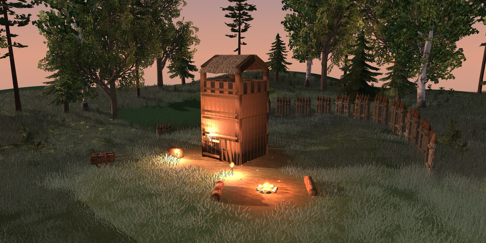
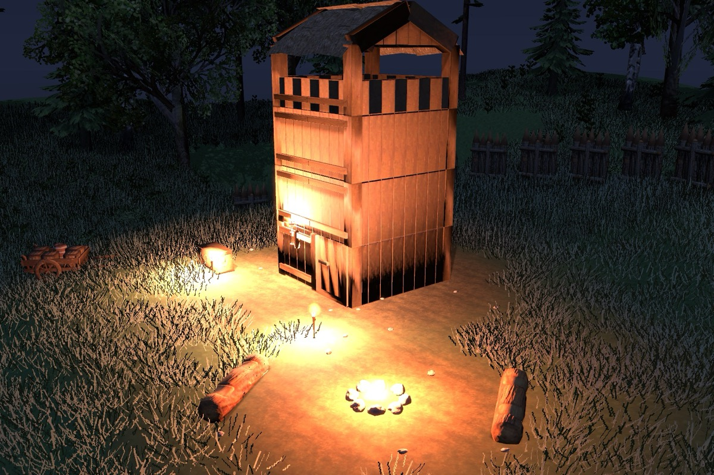
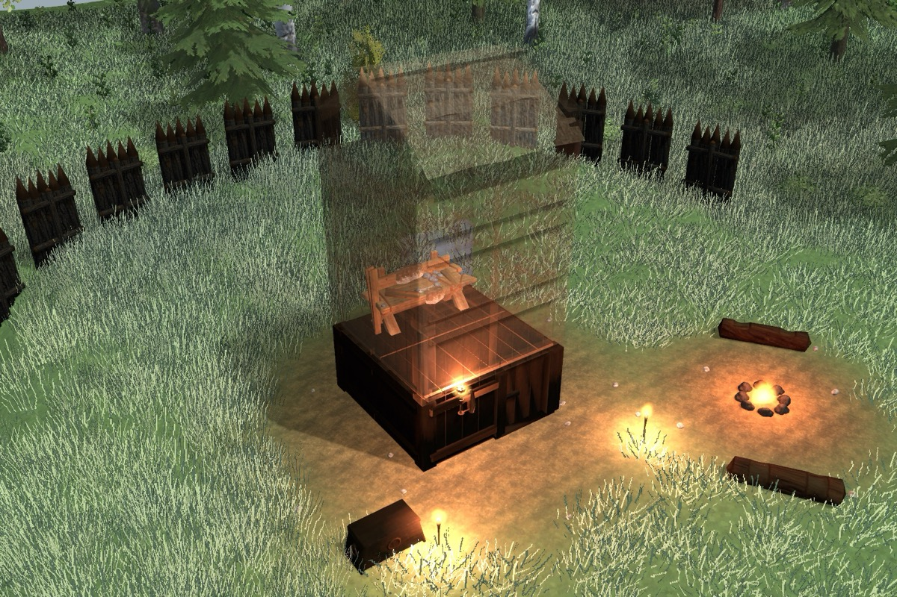
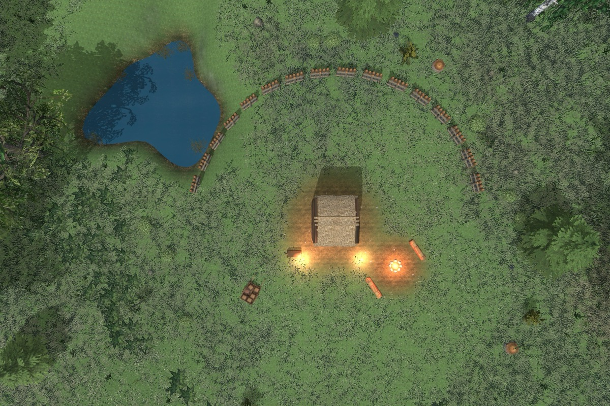

<p align="center">
  
</p>

<h1 align="center">Munin</h1>

<p align="center">
  A macOS app that shows how your Valheim builds were put together.
</p>

<p align="center">
  
</p>

<table>
  <tr>
    <td width="33%"></td>
    <td width="33%"></td>
    <td width="33%"></td>
  </tr>
  <tr>
    <td align="center"><sub>Fires burn by the game's own light</sub></td>
    <td align="center"><sub>Cut a build to see how it went up</sub></td>
    <td align="center"><sub>Plan view</sub></td>
  </tr>
</table>

You built a tower months ago and no longer remember how. Munin reads your world
save and rebuilds any part of the world in 3D with the game's own meshes and
textures: every piece where you placed it, plus the terrain, trees, rocks, grass and
fires around it. Step through a build layer by layer to see which piece went where.

*Munin is Odin's raven of memory, who flies over the world and remembers it.*

## Features

- **The whole world on a map.** Your builds are circled; click anywhere to open that
  area in 3D.
- **Real shapes.** Meshes, textures and normal maps come from your own copy of the
  game, mods included. Nothing is approximated with boxes.
- **The real ground.** An optional in-game plugin exports the terrain from the game's
  own world generator; your terraforming is read from the save. Grass follows the
  game's own scattering rules.
- **Layer by layer.** Cut a build at any height, with the layers above ghosted or
  hidden, to see how it went up.
- **Time of day.** The sun moves across the sky. Fires, torches and braziers carry the
  game's own lights and burn only if the save says they have fuel. Grass and trees
  sway, water ripples, flames rise.
- **Hover for details.** Name, offset from the centre and facing of any piece.
- **Save a build** to a small JSON file that opens without the world.
- **Try a plan on the real world.** A plan file lists pieces to add and remove; Munin
  shows the world as the plan would leave it, next to the save. The save is never
  touched.

## Install

You need macOS 14 or later, on Apple silicon or Intel, and Valheim installed through
Steam on the same Mac.

1. **Download** `Munin-<version>.zip` from
   [Releases](https://github.com/dmshm/munin/releases/latest), unzip it and move
   Munin to Applications.
2. **Open it once by hand.** Munin is not notarized: that needs a paid Apple developer
   account. The first time, macOS says it can't check the app. Click **Done**, open
   **System Settings › Privacy & Security**, scroll down to the message about Munin
   and click **Open Anyway**. From then on it opens normally.
3. **Set up the game assets:** **Munin › Set Up Game Assets…**, or the button in the
   window. Munin reads the meshes and textures from your copy of Valheim, including
   your mods if r2modman or r2modmac manages them. The first run downloads two Python
   libraries (UnityPy and numpy) into Munin's own folder. It then takes about three
   minutes and 6 GB of memory. If the Mac has no Python yet, macOS offers to install
   the Command Line Tools, which include it. Run the setup again after a game update
   or after adding a world.
4. **Open a world.** Single-player saves show up by themselves. To open a map a
   friend sent you, drop the `.zip` onto the window. To send one, open the world and
   choose **File › Export Map…**. That makes one zip with the save and its terrain.

## Build from source

- macOS 14 or later, with Swift 6 (Xcode 16 or the Command Line Tools)
- Valheim installed through Steam, for the meshes and textures
- Python 3, to extract them
- Optional: the .NET SDK and [BepInEx](https://thunderstore.io/c/valheim/p/denikson/BepInExPack_Valheim/)
  (for example through r2modman), for the exact terrain

Munin ships no game assets. They are extracted from your copy of the game into
`~/Library/Application Support/Munin/catalog`, by **Set Up Game Assets…** in the app
(`tools/setup_assets.sh`) or by hand as below.

**1. Get your world.** Single-player saves are in
`~/Library/Application Support/IronGate/Valheim/worlds_local`. For a dedicated server,
`tools/fetch_world.sh` downloads the latest world over FTP. It reads `FTP_HOST`,
`FTP_PORT`, `FTP_USER`, `FTP_PASSWORD` and `WORLD_NAME` from an env file that you
keep outside the repository:

```bash
tools/fetch_world.sh ~/path/to/server.env
```

**2. Extract the meshes.** Run this once, and again after a game or mod update, or when
your world gains new kinds of props. It takes about 2 minutes and 6 GB of RAM.

```bash
python3 -m venv /tmp/munin-venv && /tmp/munin-venv/bin/pip install UnityPy numpy
/tmp/munin-venv/bin/python tools/extract_meshes.py \
  --world "$HOME/Library/Application Support/Munin/worlds/<world>" \
  --extra "<your BepInEx profile>/BepInEx/plugins"
```

- `--world` also extracts the trees, rocks and creatures that world uses. Without
  it, areas show only your build.
- `--extra` adds modded pieces. Without it they draw as pink boxes.

**3. Build and open the app.**

```bash
app/bundle.sh && open app/Munin.app
```

`app/bundle.sh --release` builds for Apple silicon and Intel and zips the app into
`app/dist/`, ready to attach to a release.

Munin lists the worlds it finds: single-player saves in Valheim's own save folder, and
server worlds downloaded with `tools/fetch_world.sh`. Click one to open it. Next time,
Munin reopens the last world by itself, and the world's name in the sidebar switches to
any other in one click. A shared map (`.zip`, from **File › Export Map…**) can be
dropped on the window; it is unpacked into Munin's own folder. For a save kept anywhere else, use **Open Other…** (⌘O) or drop
it on the window: a chunked world folder, any file inside one, an older single-file
`<world>.db`, or a saved build `.json`. It is remembered from then on.

**4. Optional: the exact terrain.** A save holds only your edits to the terrain, not
the terrain itself, so without this step Munin estimates the ground from where trees
and rocks stand. To get the real terrain, build the plugin and copy it into your BepInEx
profile:

```bash
cd mod && dotnet build -c Release -p:BepInExCore="<your BepInEx profile>/BepInEx/core"
cp bin/Release/netstandard2.1/MuninExporter.dll "<your BepInEx profile>/BepInEx/plugins/MuninExporter/"
```

Open the world in Munin once, which writes the list of zones you have explored. Then
join the world in game, press F5 and type `munin_export`. The plugin is read-only: it
changes nothing in the world.

## Controls

Both the map and the 3D view move like Google Maps.

| | |
| --- | --- |
| Move | drag (let go while moving and it glides), or arrows / W A S D |
| Zoom | scroll or pinch, toward the cursor; + and −; or the buttons bottom right |
| Zoom in on a spot | double-click |
| Rotate and tilt | ⌃-drag, ⌥-drag or right-drag; ⇧-arrows; two-finger rotate |
| North up | click the compass, bottom right |
| Look straight down | the 2D / 3D button, bottom right |
| Layers | `[` and `]`, or the slider |

A large 3D view renders at most about 7 million pixels and is scaled up to fit:
frame cost follows the pixel count, and a full-screen view on a 5K display has
12 million. **View › Full Resolution** renders every pixel instead.

## Plans

A plan is a change you are thinking about, written down before you build it: what
to take away and what to put up. Open or drop one while a world is open and Munin
lays it over that world, in memory only. The sidebar shows the plan's name, how many
pieces it adds and removes, and a switch to see the world with it or as saved. The
plan is remembered for that world and goes back on when the world opens again;
**Clear** takes it off, **Reload** reads the file again after you edit it. If the
file cannot be read when the world opens, the plan stays remembered, with **Retry**
once it is fixed and **Forget**. A plan opened with no world open goes over the last
world opened; so does `Munin --open plan.json` at launch.

```json
{
  "format": "munin-plan/1",
  "name": "Castle walls",
  "remove": [ {"prefab": "stone_wall_4x2", "pos": [10.5, 32.7, 20.1]} ],
  "add":    [ {"prefab": "stone_wall_2x1", "pos": [14, 31, 18], "rot": [0, 90, 0]} ]
}
```

- Positions are the game's world coordinates in metres: x east, y up, z north, as
  the save stores them. `rot` is the game's Euler angles in degrees, and may be left
  out.
- `prefab` is a name or, for a piece the catalog has no name for, its hash.
- Each removal takes a built piece of that prefab within 10 cm of `pos`, the closest
  one unless another removal can only reach that one; a removal's `rot` is not read.
  Trees, rocks and other things the world grew are never removed. A removal that
  finds nothing is counted and shown, not an error.

## Repository

| Path | What |
| ---- | ---- |
| `app/` | SwiftUI + SceneKit app, built with SwiftPM (no Xcode project). `MuninCore` holds the save reader, clustering, terrain and region cutting; it has no UI, so it is tested on its own. |
| `app/Icon/` | The app icon, drawn in code (`make_icon.swift`). |
| `tools/extract_meshes.py` | Pulls meshes, textures, lights and the grass rules out of a local Valheim install into the catalog the app reads. Mod bundles embedded in DLLs are cut out and included. |
| `tools/setup_assets.sh` | What **Set Up Game Assets…** runs: finds the game, Python and your mods, then runs the extractor. |
| `tools/fetch_world.sh` | Downloads the latest world from a dedicated server over FTP. |
| `mod/` | `munin_export`, a small read-only BepInEx plugin that asks the game's world generator for the terrain of every explored zone. |

### Headless render

```bash
app/Munin.app/Contents/MacOS/Munin --snapshot <world|build.json> <out-dir> [build-index | x,z] [radius]
```

This writes one PNG per view preset, plus two close-ups, without opening a window.
`--plan <plan.json>`, anywhere on the line, lays a plan over the world first:

```bash
app/Munin.app/Contents/MacOS/Munin --snapshot <world> <out-dir> 165,-15 80 --plan plan.json
```

`--showcase <out-dir>` renders the pictures at the top of this README: the example
watchtower in a made-up meadow, so no one's world is needed.
`MUNIN_HOUR=22` renders at night, and `MUNIN_TIMING=1` prints how long each loading
step and a few frames take. In the app, `MUNIN_STATS=1` shows SceneKit's frame
statistics and prints the frame rate and rendered size once a second.

### Tests

```bash
cd app && swift test
MUNIN_TEST_WORLD=/path/to/world swift test   # also parse a real save
```

## How the save is read

Valheim stores the world as ZDOs, its networked objects. Each has a prefab hash, a
position, a rotation and typed key/value fields. They are not length-prefixed, so
every field of every object gets walked. Player-built pieces are the ones with a
`creator` field. Prefab names are stored only as hashes; they are resolved against
the names in the mesh catalog, and unknown ones show as `#<hash>`.

**Single-file saves** (world versions 33–41, `<world>.db`) were cross-checked
against [Kakoen/valheim-save-tools](https://github.com/Kakoen/valheim-save-tools).
No code was copied from it.

**Chunked saves** (version 42, Valheim 1.0) had no public description. The layout
below was worked out from real saves, and every chunk of a 533k-object world parses
to its last byte:

- `_main.<n>.db2`: 16-byte header (int32 version, double net time, int32 length),
  then gzip. It holds zones and events, not objects.
- `_main.<n>.chunks`: index of chunks and their object counts.
- `<a>_<b>__<kind>_<revision>.chunk`: uint16 version, int32 count, then compact ZDOs.
  The highest revision of each chunk wins.
- A compact ZDO differs from the old one in three places:
  - there is no sector field;
  - flag `0x2000` stores the position as int16 x and z, with y = 0 (zone anchors);
  - the rotation is in half-degree steps. A first uint16 with its top bit set is
    yaw only; otherwise a second uint16 follows, and `second | first << 16` packs
    `x | y << 10 | z << 20`.

**Terrain edits** live on `_TerrainCompiler` objects. Each holds a gzipped grid of
65 × 65 vertices per zone. Each vertex may carry a level-and-smooth height delta and
an RGBA paint (dirt, cultivated, paved).

## What is real and what is estimated

- **Real:**
  - every object's position, rotation and scale;
  - the meshes, textures and normal maps, taken from the game itself;
  - point (nearest) filtering where the game uses it. That is most textures, and
    it's why they look crisp despite being only 64–512 px;
  - each light's colour, range and flicker, and whether a fire has fuel.
- **The ground:**
  - **Exact, with `munin_export`.** The plugin runs the game's world generator for
    every explored zone (height, biome, mask and forest factor, every 1 m), and Munin
    adds the edits from the save.
  - **Textured from the game's own terrain layers.** Which layer belongs to which
    biome is decided by the game's compiled shader, so that mapping was made by eye.
    Steep ground turns to rock, and beaches to sand.
  - **Grass and ground cover follow the game's `ClutterSystem` rules:** biome, density
    per 8 m patch, slope, height above the sea, cleared ground and forest thresholds.
    The noise that makes grass patchy is internal to the game and approximated, so
    placement is deterministic but not blade-for-blade the game's.
  - **Estimated without the export,** from where trees, bushes and rocks stand.
- **Left out:** dropped items; dungeon interiors (crypts and caves sit about 5000 m
  up, above their entrances); creature animation, so creatures stand in their rest
  pose.

Valheim (Unity) is left-handed with z pointing north, and SceneKit is right-handed.
Positions are converted by flipping z, rotations by `(-x, -y, z)` in Unity's
Z→X→Y order, and triangle winding is reversed.

## Licence

[MIT](LICENSE). The code only: Valheim's meshes, textures and other assets belong
to Iron Gate and are never part of this repository.

Munin is a fan project. It is not affiliated with or endorsed by Iron Gate AB or
Coffee Stain. Valheim is a trademark of Iron Gate AB.
